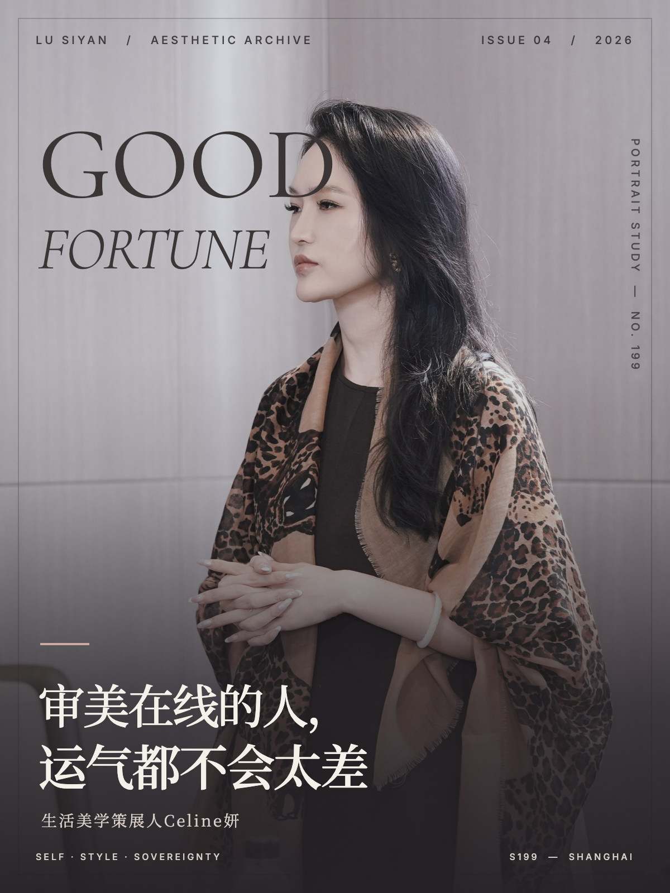

# 人物封面视觉路由 Skill

给大模型用的一套人物封面工作流。

你给它一张照片和一句标题，它会先看照片：人物站在哪、哪里留白、光线是亮是暗，然后再决定怎么排版。最后给你一份可以直接打开的单文件 HTML，而不是不管什么照片都套同一个模板。

## 先看看做出来的样子


<table>
  <tr>
    <td></td>
    <td></td>
    <td></td>
  </tr>
  <tr>
    <td align="center">满版大字先锋杂志风</td>
    <td align="center">暗调电影情绪风</td>
    <td align="center">侧脸分栏竖刊风</td>
  </tr>
</table>

这些图是陆思妍系列案例，用来看排版和完成度。换成其他人物时，会重新诊断照片，不会把这里的署名、颜色和风格直接套过去。

## 最简单的用法

### 豆包、元宝或其他大模型

先下载完整材料包：

**[下载 portrait-cover-router-skill.zip](https://github.com/linssenstudio/portrait-cover-router/releases/latest/download/portrait-cover-router-skill.zip)**

把 ZIP 上传给模型，再发这段话：

```text
请先阅读 portrait-cover-router/SKILL.md 和 references/style-library.json。
接下来我会上传人物原图和封面文案，请按照里面的步骤做：先诊断照片，再选择最合适的封面风格，最后输出完整 HTML。
不要继承案例里的人物署名。能做渲染检查时，请导出图片并实际看一眼。
```

然后上传照片，告诉它封面标题，例如：

```text
这是人物原图，标题是《审美在线的人，运气都不会太差》。
请做成 600×800 的封面，标题不要挡住五官。
```

模型需要能看图片、读文件。如果它不能解压 ZIP，就分别上传 `SKILL.md`、`references/style-library.json` 和相关参考图；也可以直接复制 `prompts/standalone-prompt.txt` 里的内容给它。

### Kimi Code 或其他支持 Skills 的工具

把整个 `portrait-cover-router` 文件夹放进工具使用的 Skills 目录，按工具自己的方式启用。不要只复制 README。

也可以克隆项目：

```bash
git clone https://github.com/linssenstudio/portrait-cover-router.git
```

## 它具体会做什么

1. **先看照片**：判断是特写、半身还是环境照，找安全留白，提取照片里的颜色。
2. **再选版式**：从 12 种风格里选一种。脸特别大就减少文字，背景乱就用留白框或局部渐变，有干净墙面就把标题放进留白。
3. **写出完整 HTML**：默认 600×800、3:4，可以直接打开截图，也可以继续改文字和照片路径。
4. **能渲染就复查**：检查人物裁切、文字溢出、字体加载和可读性。没法渲染时，会明确说明还没有做过视觉检查。

## 文件都在哪

```text
portrait-cover-router/
├── SKILL.md                         核心执行流程
├── assets/base_cover.html           可修改的 HTML 起点
├── prompts/standalone-prompt.txt    不能直接读 Skill 时使用的提示词
├── references/
│   ├── style-library.json           12 种模板和原图适用条件
│   ├── social/                      41 张社媒封面参考
│   ├── independent/                 独立生活空间封面参考
│   └── editorial/                   8 张 Behance 编辑参考
└── examples/                        17 张成品案例和总览
```

## 使用前知道这几件事

- 模板里的 `{{...}}` 是占位符，要换成当前照片和文案。
- Google Fonts 和 Tailwind CDN 需要联网；要离线使用，就改成本地字体和纯 CSS。
- 参考图用来研究版式，不代表可以直接拿去商用。来源记录保留在 `references/` 里。
- 原图诊断必须基于真实照片。模型看不到图片时，不应凭空编造光影、构图和颜色。
